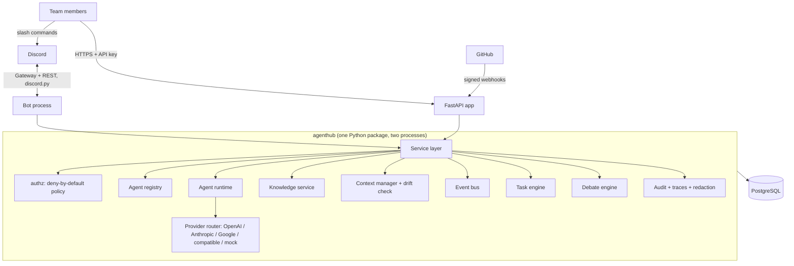
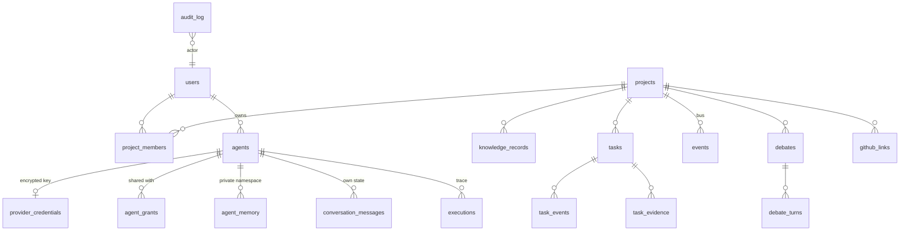

# AgentHub — Architecture (Phase 0)

Status legend used throughout the docs: **[implemented]** = code exists and is covered by tests,
**[implemented, untested live]** = code exists but was not exercised against the real external
service (no credentials in the build environment), **[planned]** = design only.

## 1. Problem and scope

A small team (each person owning several AI agents on different model providers) needs one place
where those agents share an approved, versioned picture of the project, coordinate work, and
debate, without any person gaining access to another person's agents, keys or private history.

The five problems and the mechanism that addresses each:

| Problem | Mechanism |
|---|---|
| Context drift | Project-level `context_version` counter bumped on every verified-knowledge change; every task, event and execution records the version it used; `ContextService.check_drift` compares and returns the newer records. |
| Knowledge fragmentation | One `knowledge_records` store with four visibility classes (verified / proposed / agent-private / execution history), all addressable by ID and linked to tasks and debates. |
| Coordination failure | Durable event bus (`events` table) with envelope, ack, dedup and hop limits; task state machine; structured handoff reports. |
| Human knowledge gaps | Discord is a readable projection of events; every task has a handoff report and evidence list; debates end in a written summary with disagreements and uncertainties. |
| Access-control conflicts | Deny-by-default `authz` module called by every service method, keyed on immutable Discord user IDs; per-agent encrypted credentials; private memory scoped by agent ID. |

**In scope for the prototype:** single server, single Postgres, Discord bot + REST API, OpenAI /
Anthropic / Google / OpenAI-compatible adapters, deterministic (metadata-based) context retrieval,
bounded debates, GitHub webhook ingestion.

**Out of scope for now:** sandboxed code execution for coding agents (designed, not built — see
§9), vector search, A2A interoperability, a web UI, multi-tenant SaaS.

## 2. Requirements

### Functional
- F1 A user owns N agents (admin-limited). Each agent has ID, owner, name, description, role,
  provider + model config, system instructions, own conversation state, private memory namespace,
  allowed tools, status, concurrency and budget limits, and an auditable execution history.
- F2 Owners manage their agents; others can only use an agent through an explicit, scoped grant.
- F3 Shared knowledge with states `proposed → verified | rejected`, `verified → superseded | deprecated`.
  Only humans with the maintainer role on the project can verify.
- F4 Task-specific context package per execution, carrying the context version.
- F5 Drift detection when an agent references an outdated decision or version.
- F6 Agent-to-agent messages as structured envelopes with ack, dedup, hop limit, timeout.
- F7 Bounded debates with roles, independent first round, critique/rebuttal rounds, synthesis,
  human approval, and persistence of the approved decision as verified knowledge.
- F8 Task lifecycle `backlog → assigned → in_progress → review → approved → completed`, plus
  `blocked`, `failed`, `cancelled`; completion requires evidence and human approval.
- F9 GitHub webhook ingestion linking PRs/commits to tasks and tracking repo head revision.
- F10 Execution tracing (prompt, response, model, tokens, cost estimate, duration, errors, context version).

### Non-functional
- Deny by default; authorization enforced in the service layer, never by the LLM.
- All state in Postgres; survives restarts.
- Secrets encrypted at rest (Fernet), never logged, never placed in prompts, redacted from traces.
- Bounded everything: debate rounds, hops, tokens, money, wall-clock timeouts.
- Deployable with `docker compose up` on one machine.

## 3. Architecture

Two processes share one package: `agenthub.api` (FastAPI) and `agenthub.discord_bot` (discord.py).
They do not call each other; both call the service layer, which owns all authorization.
This replaces the suggested microservice tree with modules behind plain Python interfaces
(see ADR-0001). Redis is **not** used: Postgres provides the durable queue and the counters the
prototype needs (ADR-0003).

### Component responsibility matrix

| Module | Owns | Must not |
|---|---|---|
| `authz.py` | Every allow/deny decision | Read prompts or LLM output |
| `services/agents.py` | Agent CRUD, grants, credentials | Return decrypted credentials to callers |
| `services/runtime.py` | One agent execution: context → provider → trace | Bypass budgets or authz |
| `providers/*` | HTTP to a model API | Touch the DB |
| `services/knowledge.py` | Records, state transitions, context version | Promote anything without a human maintainer |
| `services/context.py` | Context packages, drift detection | Include another agent's private memory |
| `services/bus.py` | Envelopes, delivery, ack, dedup, hop limits | Execute tools |
| `services/tasks.py` | Task state machine, evidence, handoffs | Approve on an agent's word |
| `services/debate.py` | Debate rounds, budgets, synthesis | Run unbounded loops |
| `services/github.py` | Webhook verification, PR/commit links, repo head | Push or merge |
| `discord_bot/` | Map Discord users and commands to service calls; project events to channels | Make authorization decisions |

## 4. Data model

Key decisions:
- `users.discord_id` is the immutable identity; usernames are display only.
- `knowledge_records` is append-only per logical record: a new revision is a new row with
  `supersedes_id`; `projects.context_version` increments when the verified set changes.
- `executions` = execution history (category D). Visibility: owner + project maintainers;
  prompt/response text is redacted before storage.
- Model ≠ agent definition ≠ agent instance ≠ task: `agents` holds the definition (with
  provider/model), `agent_sessions` is a running conversation (instance), `tasks` is work.

## 5. Authentication and authorization

- **Humans, REST:** Discord OAuth2 (`identify` scope) → user row keyed by Discord ID → API key
  (random 32 bytes, only SHA-256 stored) returned once. `Authorization: Bearer <key>`.
- **Humans, Discord:** the bot resolves `interaction.user.id` to the user row. Discord itself has
  authenticated the user; the bot never trusts IDs typed into message text.
- **GitHub:** `X-Hub-Signature-256` HMAC check, constant-time compare.
- **Agents never authenticate as themselves.** An agent acts only inside an execution started by
  an authorized human (or by a debate/task that a human started and that the policy permits).

Policy (all in `authz.py`, every function raises `Forbidden` unless a rule allows):

| Action | Allowed for |
|---|---|
| Create agent | any project member, under `max_agents_per_user` |
| Reconfigure / delete / set credential / read private memory or private traces | owner only |
| Execute agent | owner, or a user holding a grant with `execute` on that agent |
| Include agent in debate/task | owner, or grant with `collaborate` |
| Propose knowledge | project member (agents propose through their execution) |
| Verify / reject / supersede / deprecate knowledge, approve task, approve debate decision | project `maintainer` |
| Read shared traces | project members, only fields marked shared |

A grant never confers reconfigure, credential or memory access (rule 7 of the brief).

## 6. Key sequences

**Ask an agent (Phase 1 vertical slice)**
1. `/agent ask <agent> <prompt>` → bot → `runtime.execute(actor, agent_id, prompt, task_id?)`.
2. `authz.can_execute`, budget check, concurrency check (`running_executions < max_concurrency`).
3. `context.build_package(project, task)` → verified knowledge + task + deps + prior failures +
   open questions + current `context_version`.
4. Provider adapter call with timeout; tokens and cost recorded; output redacted.
5. Conversation message + execution row persisted; event `agent.response` published; Discord shows it.

**Drift (Scenario D):** an agent's handoff/proposal carries `context_version` and referenced
record IDs. `check_drift` flags references to records that are `superseded`/`deprecated` or a
version older than the project's, and returns the current replacements.

**Debate:** create → select authorized agents (+roles) → round 0 independent proposals (each agent
sees only the problem + context, not other proposals) → critique rounds (each sees all prior turns)
→ stop on max rounds / token budget / cost budget / no new objections → synthesizer produces
summary JSON → human maintainer approves → summary stored as verified decision → `context_version`
bumps → event to participants. A failed agent turn is recorded as `failed` and the round continues.

## 7. Technology trade-offs

| Choice | Why | Rejected |
|---|---|---|
| Modular monolith, 2 processes | Small team, one server, simpler auth boundary | Microservices |
| Postgres as queue (`events`, `FOR UPDATE SKIP LOCKED`) | Durable, already required, survives restart | Redis streams (extra moving part, persistence config) |
| Own debate loop | ~200 lines, fully bounded and testable | LangGraph (worth it once workflows get branchy) |
| Deterministic retrieval by project/status/tags/task links | Predictable, explainable | pgvector now (add when record count justifies it) |
| Raw HTTP adapters via httpx | No SDK lock-in, one interface, easy to mock | Four vendor SDKs |
| Own trace table | Works offline; `TraceSink` interface allows Langfuse later | Langfuse as hard dependency |
| discord.py | Official API, maintained, app commands | Custom gateway client |

## 8. Risks and assumptions

- Assumes each agent has an **API key**; consumer chat subscriptions do not provide API access.
- Prompt injection via Discord text, repo content or tool output: mitigated by (a) agents having
  no privileged tools in the prototype, (b) authorization never derived from model output,
  (c) untrusted content wrapped and labelled in prompts. Not eliminated.
- Cost estimates use a static price table; real bills can differ.
- Discord message limits (2000 chars): long outputs are truncated in Discord and kept in full in DB.
- Single maintainer approval is a bottleneck by design.

## 9. Roadmap

| Phase | Content | Status |
|---|---|---|
| 0 | This document, ADRs | done |
| 1 | Users, agents, grants, credentials, providers, runtime, conversation state, knowledge store, bot, API, compose | see `docs/STATUS.md` |
| 2 | Versioned knowledge, context packages, drift, tasks, handoffs, event bus, GitHub webhooks, traces | see `docs/STATUS.md` |
| 3 | Debate engine | see `docs/STATUS.md` |
| 4 | Sandboxed execution for coding agents (container per task, no network by default, worktree per branch), Langfuse sink, pgvector, A2A gateway, load tests | planned |
